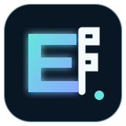
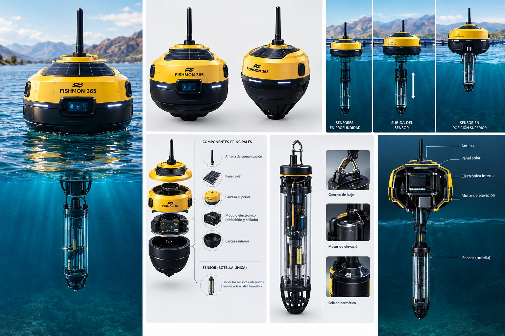
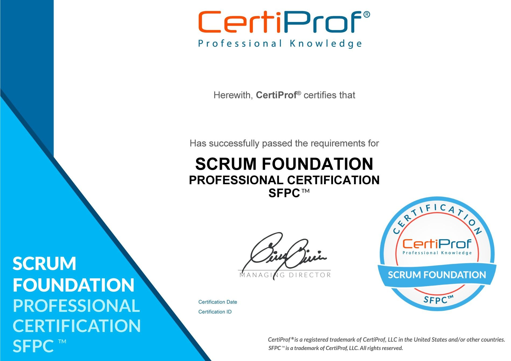
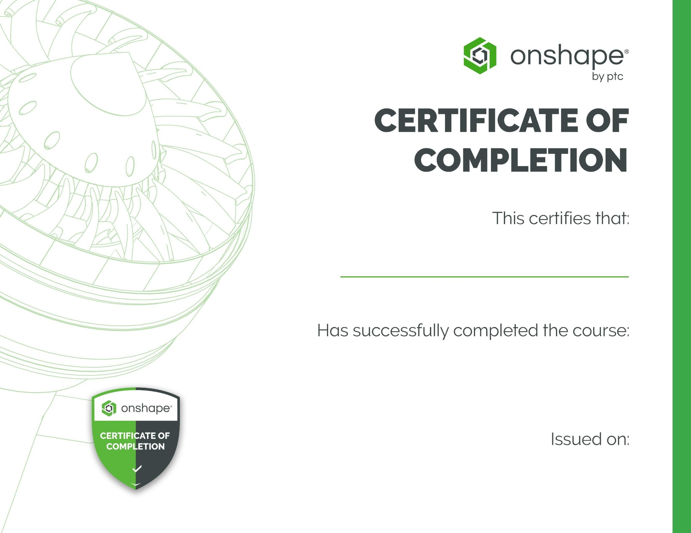

# Eber Pauccara Huancara

**Estudiante de Ingeniería Industrial · Universidad Peruana Cayetano Heredia**

**Innovación · Tecnología · Investigación · Optimización de procesos**

---

## Sobre mí

Soy estudiante de **Ingeniería Industrial del VII ciclo** de la Universidad Peruana Cayetano Heredia. Me interesa conectar la ingeniería, los datos y la tecnología para analizar problemas y desarrollar soluciones aplicables a entornos reales.

Mis áreas de interés y desarrollo incluyen **optimización de procesos, ergonomía, análisis estadístico con R/RStudio, diseño y modelado 3D, investigación y desarrollo de proyectos tecnológicos**.

Me motiva aprender de forma continua, trabajar en equipos multidisciplinarios y transformar ideas en propuestas con utilidad práctica.

## Áreas de interés y competencias

| Área | Enfoque |
|---|---|
| Optimización de procesos | Análisis, mejora y representación de procesos |
| Ergonomía | Factores humanos, condiciones de trabajo y prevención |
| R / RStudio | Análisis estadístico y exploración de datos |
| Diseño 3D | Modelado y desarrollo de componentes |
| Gestión de proyectos | Organización, trabajo colaborativo y enfoque ágil |
| Investigación y desarrollo | Formulación y evaluación de soluciones tecnológicas |

## Proyecto destacado

### Fishmon 365 — Boya inteligente para monitoreo de calidad del agua

Proyecto de investigación y desarrollo orientado al monitoreo de variables de calidad del agua en ambientes acuícolas. La propuesta busca contribuir a la toma de decisiones y a una gestión más informada de las condiciones del entorno.

He participado en el desarrollo de la propuesta, el diseño de la boya y la coordinación del equipo de trabajo.

  

## Formación y participación

- **Ingeniería Industrial — Universidad Peruana Cayetano Heredia**, VII ciclo.
- **Scrum Foundation Professional Certification (SFPC™)** — CertiProf, 2024.
- **Onshape Assemblies – Multi-Part Studios** — Onshape by PTC, 2025.
- **Expositor** del taller “Salud Ocupacional y Prevención de Riesgos Laborales”, organizado por la UPCH, octubre de 2026.
- Participación en actividades académicas y visitas técnicas industriales.

## Certificaciones

  
  

  <a href="assets/constancia-expositor.jpg">Ver constancia de participación como expositor</a>

## Herramientas y tecnologías

  
  
  
  

*Las herramientas se presentan como áreas de trabajo y aprendizaje; no se asignan porcentajes ni niveles de dominio no acreditados.*

## Contacto

- **GitHub:** [@Eber-123](https://github.com/Eber-123)
- **Correo:** [eberpaucara@gmail.com](mailto:eberpaucara@gmail.com)
- **LinkedIn:** [Perfil profesional](https://www.linkedin.com/in/eber-pauccara-huancara-137011394/)
- **Portafolio:** publicar aquí la URL definitiva de GitHub Pages cuando esté disponible.

---

**Construyendo soluciones mediante ingeniería, análisis e innovación.**

